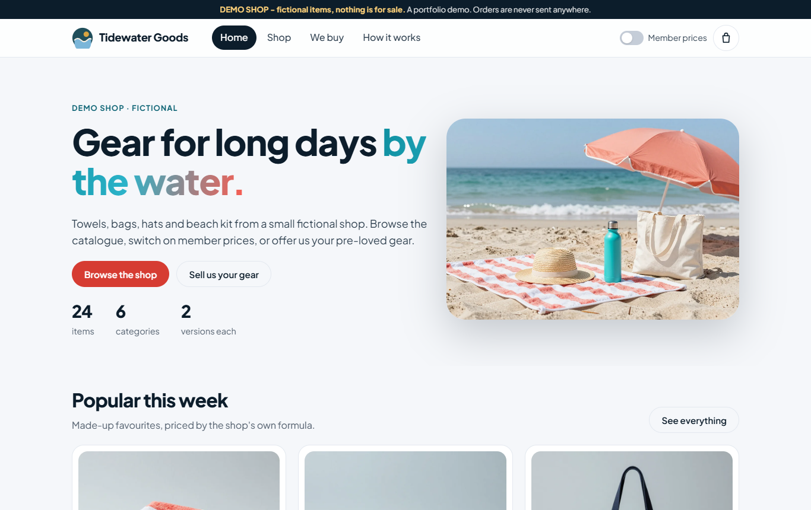
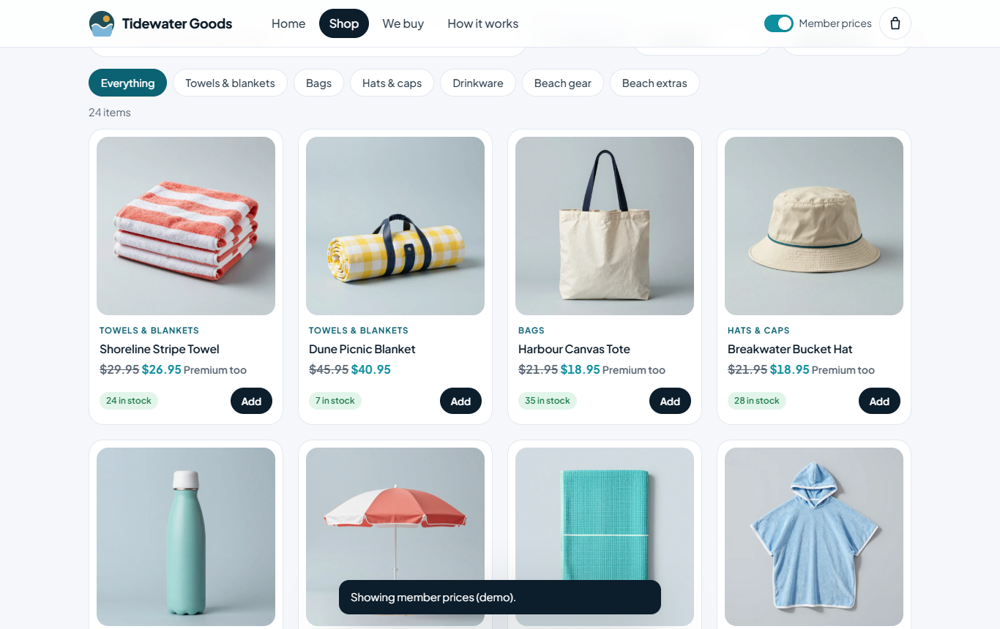
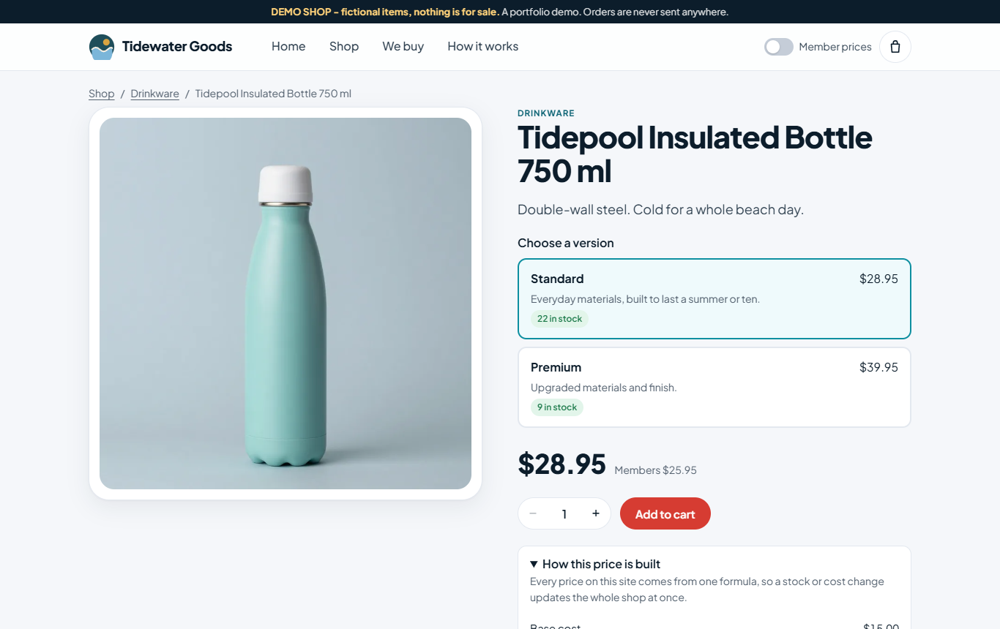
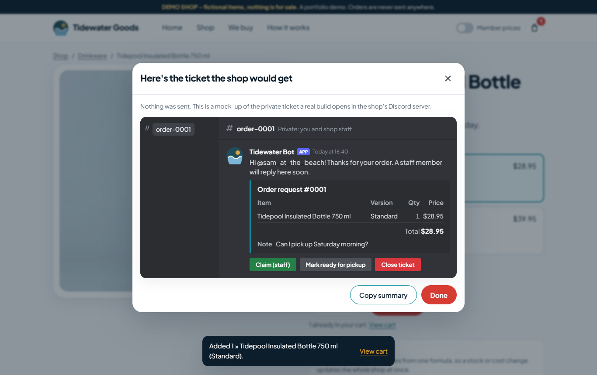
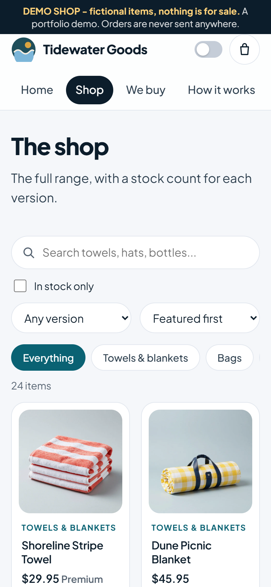

# Tidewater Goods: demo shop

**A fictional shop. Nothing is for sale, and no order is ever sent anywhere.**

Tidewater Goods is a sample build of a small online shop that takes orders through Discord instead of a card checkout.
It shows what a "catalogue + order-request site" looks like before it's made for a real business.

| Home | Shop (member prices on) | Price breakdown |
|---|---|---|
|  |  |  |

| The Discord ticket preview | On a phone |
|---|---|
|  |  |

## What it does

| Feature | In this demo |
|---|---|
| Catalogue | 24 made-up items in 6 categories, with search, category filters, sorting, a version filter and an in-stock filter |
| Versions and stock | Each item has a Standard and a Premium version with its own stock count; sold-out versions can't be added |
| Price engine | One formula prices everything: `cost × version factor × (1 + category markup)`, rounded up to a .95 price. Every product page shows the working |
| Member prices | A header switch shows member prices (at least 10% off, rounded down to a .95 price). Demo only: there are no accounts |
| Cart | Kept in the visitor's own browser (`localStorage`, along with the member switch and a ticket counter); quantities are capped at the stock left |
| Order request | Name, optional Discord username and a note, then a preview of the private Discord ticket the shop would get |
| We buy | A buy-back page with condition grades (Fair / Good / Like new), an instant estimate and a per-request limit |
| Pictures | AI-generated studio product photos made for this demo (`assets/img/products/`, WebP). They show made-up, unbranded products: no real brands, logos or people. If an item has no photo, a flat illustration drawn in code (`assets/js/art.js`) is shown instead |

## How it's built

- Plain HTML, CSS and JavaScript. No framework, no build step, no server.
- Data lives in two JSON files:
  - `data/items.json`: the catalogue (name, category, base cost, stock per version, colours, blurb);
  - `data/settings.json`: markups, version factors, member discount, price ending, categories and the buy-back list.
- Change a cost or a markup in the JSON and every price on the site updates.
- No cookies or analytics. The only outside request is for the web fonts (Google Fonts).
- Works on phones and desktops. Keyboard-friendly dialogs (Esc closes, focus stays inside), visible focus rings, reduced-motion support.

## Run it locally

The pages read their data with `fetch`, so open them through a web server, not as `file://`:

```
python -m http.server 8000
```

Then visit http://localhost:8000/. If you host it under a different repository name than `tidewater-demo`, change `SITE` at the top of `404.html`.

## Tests

`tests/browser_test.py` drives the real site in headless Chrome (Playwright) on a desktop and a phone-sized screen:
search, filters, stock caps, member prices, the cart, the request and ticket flow, the buy-back caps, keyboard focus,
blocked or full browser storage, corrupt saved carts and odd URLs. With the site served on port 8000:

```
pip install playwright
python tests/browser_test.py
```

## Host it for free

It's a static site, so GitHub Pages works as-is: push the folder to a repository, then turn on
Settings → Pages → "Deploy from a branch" (`main`, root). The `.nojekyll` file is already included.

## What a real build adds

- A Discord bot that opens a real private ticket for each request, with claim, close and transcripts.
- Stock that updates when staff close a sale.
- A simple staff page to edit items, costs and stock.
- Member accounts linked to Discord, if wanted.
- The client's own name, items, photos and domain.

Card checkout isn't part of this package.

## Licence

MIT. See `LICENSE`. All names, items and prices are fictional. Any resemblance to a real shop is a coincidence.
